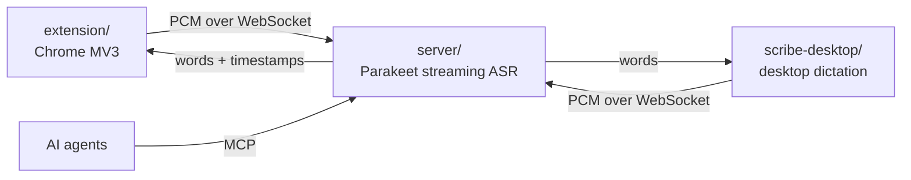

<picture><source media="(prefers-color-scheme: light)" srcset="assets/logo/scribe-light.svg"></picture>

# scribe

Live meeting transcription on your own GPU. A browser extension streams a
meeting's audio to a self-hosted speech recognition server, which sends back
captions as people talk, labels who said what, and keeps every meeting
searchable by AI agents over MCP. The same server also powers push-to-talk
dictation on the desktop.

## Architecture



| Part                                | What it does                                                                                                                                                                                                                                                                                                                                                                                       |
| ----------------------------------- | -------------------------------------------------------------------------------------------------------------------------------------------------------------------------------------------------------------------------------------------------------------------------------------------------------------------------------------------------------------------------------------------------- |
| [`server/`](server)                 | FastAPI service running NVIDIA's `parakeet-unified-en-0.6b` (NeMo) with buffered streaming on CUDA. Takes 16 kHz PCM on `/ws` and streams back words with timestamps. Also serves an OpenAI-style `/v1/audio/transcriptions` endpoint, a web UI for saved sessions, and an MCP server (`/mcp`) to list, read, and search meeting transcripts and manage a vocabulary that boosts names and jargon. |
| [`extension/`](extension)           | Chrome extension that captures a meeting tab's audio (Zoom, Google Meet) plus your own mic as a separate stream, and attributes each word to a speaker by joining word timestamps against the meeting's active-speaker indicator. Each meeting's participant names are boosted for its stream. See [`extension/README.md`](extension/README.md).                                                   |
| [`scribe-desktop/`](scribe-desktop) | AGS (GTK4) daemon for Hyprland: hold a key to talk and paste on release, or tap to type live until the next tap. Records with PipeWire and types through Hyprland. Set `SCRIBE_URL` to point it at your server.                                                                                                                                                                                    |

## Requirements

- The server: a Linux host with an NVIDIA GPU and the NVIDIA container toolkit.
  It refuses to start without CUDA. The model is downloaded from Hugging Face
  on first start.
- The extension: Chrome (or another Chromium) on any OS.
- scribe-desktop: Linux with PipeWire and a recent Hyprland (it types through
  `hyprctl eval` and the Lua dispatcher API).

> [!WARNING]
> The server has **no authentication**. Anyone who can reach it can stream
> audio, read every saved transcript and recording, and edit the vocabulary.
> Keep it on a private network (a VPN, a tailnet) or behind a reverse proxy
> that authenticates.

The extension and scribe-desktop default to the author's server,
`wss://scribe.lalala.casa/ws`. Point them at yours: the extension's options
page, and `SCRIBE_URL` for scribe-desktop.

## Server

### NixOS

```nix
{
  inputs.scribe.url = "github:xav-ie/scribe";

  outputs = { nixpkgs, scribe, ... }: {
    nixosConfigurations.gpu-host = nixpkgs.lib.nixosSystem {
      modules = [
        scribe.nixosModules.default
        {
          services.scribe.enable = true;
          # services.scribe.dataDir = "/var/lib/scribe"; # model cache, recordings, vocabulary
          # The container listens on 8000; publishing it is up to you.
          virtualisation.oci-containers.containers.scribe.ports = [ "127.0.0.1:8000:8000" ];
        }
      ];
    };
  };
}
```

The module builds the server image on the host (`build-scribe-image.service`)
so the multi-GB CUDA Python environment stays out of the Nix store, and runs it
with `podman` and the NVIDIA container toolkit.

### Without Nix

```sh
podman build -t scribe server
podman run --device nvidia.com/gpu=all -p 127.0.0.1:8000:8000 \
  -v scribe-cache:/cache -e HF_HOME=/cache/huggingface -e NEMO_CACHE_DIR=/cache/nemo scribe
```

(`docker run --gpus all ...` works the same.) Tunables such as the context
sizes and boosting strength are environment variables documented at the top of
[`server/stream_server.py`](server/stream_server.py).

### What it serves

| Route                           |                                                                                                                                                                |
| ------------------------------- | -------------------------------------------------------------------------------------------------------------------------------------------------------------- |
| `GET /`                         | Web UI: saved sessions with audio playback, live view of a recording in progress, the vocabulary editor.                                                       |
| `WS /ws`                        | Streaming recognition (protocol below).                                                                                                                        |
| `WS /ws/watch/<sessionId>`      | Follow a session's streams live, as the web UI does.                                                                                                           |
| `POST /v1/audio/transcriptions` | OpenAI-style batch transcription of an uploaded clip; replies `{"text"}`.                                                                                      |
| `/api/sessions`, `/api/vocab`   | The JSON API behind the web UI.                                                                                                                                |
| `/mcp`                          | MCP server (streamable HTTP): `list_meetings`, `get_transcript`, `search_transcripts`, cleanups (notes an agent made from a transcript), and vocabulary tools. |

### Streaming protocol

A client opens `/ws` and sends one JSON text message first:

```json
{
  "sampleRate": 48000,
  "sessionId": "<uuid>",
  "channel": "tab",
  "save": false,
  "boost": ["Ada Lovelace"]
}
```

Only `sampleRate` is required, and it must be a common rate (8, 11.025, 12,
16, 22.05, 24, 32, 44.1, 48, 88.2 or 96 kHz). `sessionId` (a UUID) groups the streams of one
meeting for the web UI; `channel` is `tab` or `mic`; `save` keeps the audio and
words under `recordings/<sessionId>/`; `boost` adds phrases (participant names)
to the vocabulary for this stream. Then it sends raw mono int16 little endian
PCM at that rate as binary messages.

The server answers with word updates:

```json
{
  "type": "words",
  "from": 3,
  "words": [{ "word": "hello", "start": 1.28, "end": 1.6 }]
}
```

Replace your words from index `from` on with `words`. Only the last word you
already have can still change (a word split across chunks), so an update never
resends the rest. Times are seconds from the stream's first sample. Send
`{"type": "end"}` to flush the audio still buffered; the server replies with the
final update and `{"type": "done"}`.

## scribe-desktop

```nix
# home-manager
{ inputs, pkgs, ... }:
let
  scribe-desktop = inputs.scribe.packages.${pkgs.stdenv.hostPlatform.system}.scribe-desktop;
  request = cmd: "busctl --user call io.Astal.scribe-desktop /io/Astal/Application io.Astal.Application Request as 1 ${cmd}";
in {
  systemd.user.services.scribe-desktop = {
    Unit.PartOf = [ "graphical-session.target" ];
    Unit.After = [ "graphical-session.target" ];
    Service = {
      Type = "dbus";
      BusName = "io.Astal.scribe-desktop";
      ExecStart = "${scribe-desktop}/bin/scribe-desktop";
      Environment = [ "SCRIBE_URL=wss://scribe.example.com/ws" ];
      Restart = "on-failure";
    };
    Install.WantedBy = [ "graphical-session.target" ];
  };
}
```

Bind one key to `request "press"` on press and `request "release"` on release
in Hyprland. Calling the daemon over D-Bus keeps tap and hold timing accurate.
Hold the key to talk; the text is typed when you let go. Tap it to type live
as you speak, until the next tap.

## Development

```sh
nix develop                  # python + pytest, ruff, nixfmt, node, pnpm
nix flake check              # ruff, nixfmt, server tests, scribe-desktop build, module eval
pytest server/tests          # the server's tests on their own (no GPU: the ML stack is stubbed)
cd extension && pnpm i && pnpm check && pnpm build

# scribe-desktop: tsc, eslint, prettier (generates GObject types first)
nix develop .#desktop -c bash -c 'cd scribe-desktop && pnpm i && pnpm check'
```

The server tests cover the HTTP and WebSocket protocol, saving, watchers,
boosting and the MCP tools with a fake recognizer; recognition quality itself
needs a GPU and real audio.

## License

MIT
