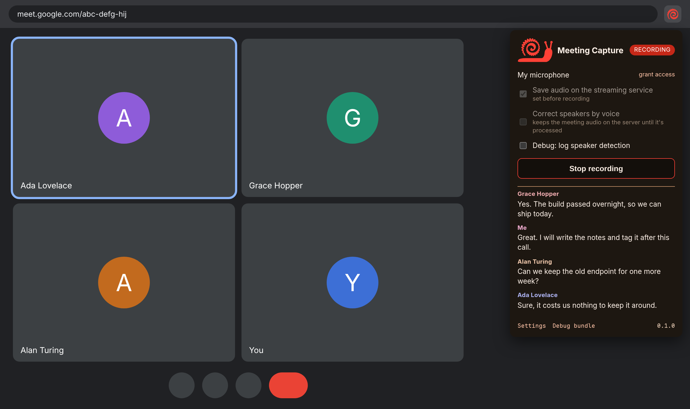
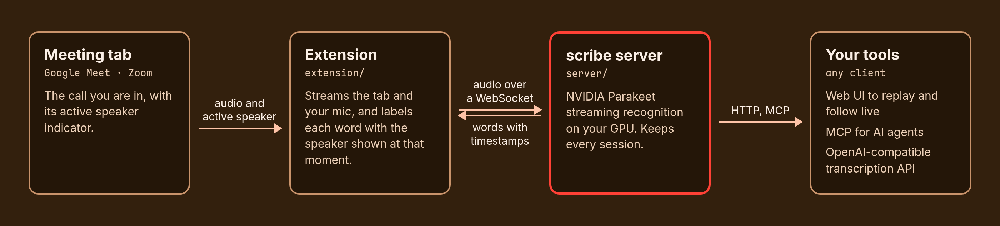
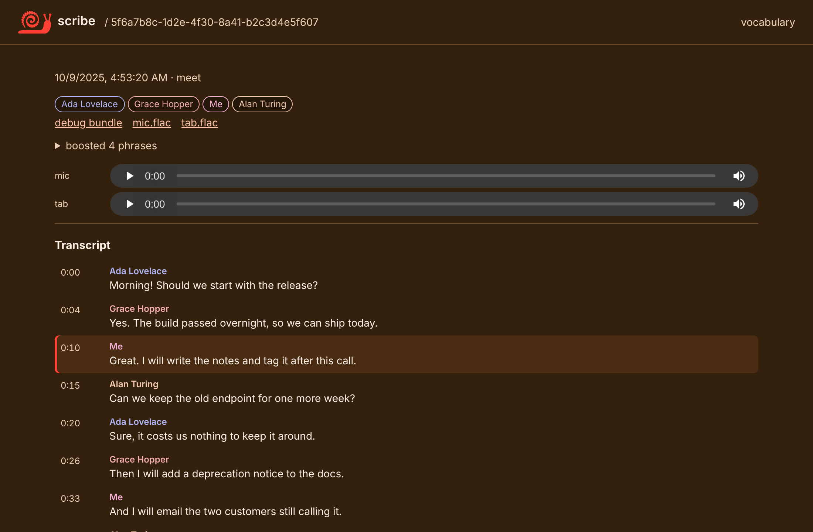
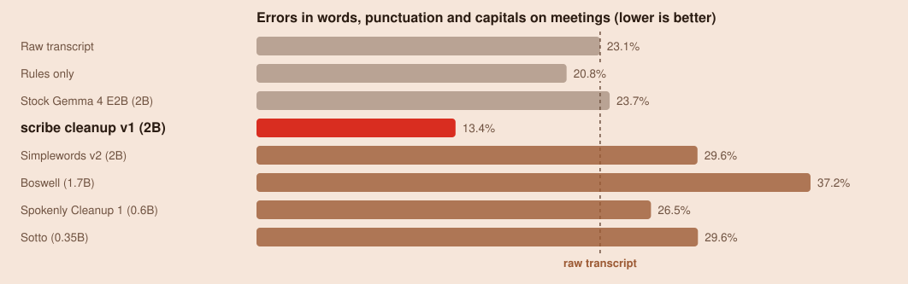

<picture><source media="(prefers-color-scheme: light)" srcset="assets/logo/scribe-light.svg"></picture>

# scribe

[](https://github.com/xav-ie/scribe/actions/workflows/ci.yml)
[](https://github.com/xav-ie/scribe/releases/latest)
[](LICENSE)

**Live meeting transcription on your own GPU, with every speaker named.** A
Chrome extension streams your Google Meet or Zoom call to a self-hosted
recognition server and shows captions as people talk. Every meeting is kept,
searchable by you and by your AI agents, and scribe's own open cleanup model can
turn it into clean, readable text without changing what anyone said.



- **Real names, not "Speaker 2".** Each word is labeled with whoever the meeting
  showed as speaking, and your own mic is labeled as you.
- **Private and fast.** NVIDIA Parakeet streaming recognition on your GPU;
  audio never leaves your network, and captions arrive within about a second.
- **Names and jargon spelled right.** A vocabulary you keep, plus each
  meeting's participant names, is boosted during recognition.
- **Clean transcripts from our own model.** [scribe cleanup v1](models/README.md)
  removes the ums, stutters and false starts and fixes punctuation and
  capitals, keeping every other word, speaker, timestamp and number. It runs on
  your own computer, and it beats every other small open cleanup model we
  measured. Optional; the original transcript always stays the record.
- **Speakers checked by voice.** Optionally, once a meeting ends, each
  speaker's voice is learned from the saved audio and speech the voice clearly
  gives to someone else moves to them, fixing the moments the meeting's
  speaker indicator lags or lights the wrong tile.
- **Every meeting kept.** Replay audio next to its transcript, or follow a
  recording live, in the server's web UI.
- **Ready for agents.** An MCP server lets AI agents list, read and search
  transcripts, keep notes on them, and edit the vocabulary.
- **An OpenAI-compatible transcription API.** `POST /v1/audio/transcriptions`
  puts the same model behind any dictation tool that speaks the OpenAI API,
  with the token as its API key.
- **Home Assistant voice.** Set `SCRIBE_WYOMING` (e.g. `0.0.0.0:10300`) and
  add it to Home Assistant's Wyoming integration to use scribe as the speech
  to text of a voice assistant.

## What you need

| Part                                           | Runs on                                                                                                                                                                                                                                                 |
| ---------------------------------------------- | ------------------------------------------------------------------------------------------------------------------------------------------------------------------------------------------------------------------------------------------------------- |
| The browser extension                          | Chrome or another Chromium browser on your computer, including a Mac, with Google Meet or Zoom open in the browser                                                                                                                                      |
| The scribe server (speech-to-text)             | a Mac with Apple silicon ([natively](#on-a-mac)), or a Linux machine with an NVIDIA GPU (in a container). It doesn't have to be the computer you take calls on: one server on your network can serve every laptop (see [Configuration](#configuration)) |
| The optional [cleanup model](models/README.md) | an NVIDIA GPU, or a Mac with an Apple chip                                                                                                                                                                                                              |

English only, for now.

## How it works



The server sends back every word with its timing, and the extension labels it
with whoever the meeting showed as speaking at that moment.

## Why scribe

Cloud note takers upload your meetings to their servers, often join the call as
a bot, and charge per seat. scribe is the opposite on all three:

- **Nothing leaves your network,** and the only cost is a GPU you already have.
- **No bot in the call.** The extension listens from your own browser tab, so
  nobody has to admit a "notetaker" into the meeting.
- **Open and yours:** MIT licensed, with transcripts in plain JSON on your disk.

## Quick start

You need Chrome or another Chromium browser, and for the server either a Linux
machine with an NVIDIA GPU (about 2.6 GB of GPU memory and 10 GB of disk) with
the NVIDIA container toolkit, or a Mac with Apple silicon (about 4 GB of free
memory and 5 GB of disk; [see below](#on-a-mac)).

1. **Run the server.** It reads its access token from a file; the model
   downloads on first start.

   ```sh
   openssl rand -hex 32 > scribe-token
   docker run -d --gpus all -p 127.0.0.1:8000:8000 -v scribe:/cache \
     -v "$PWD/scribe-token:/run/secrets/scribe-token:ro" \
     -e SCRIBE_TOKEN_FILE=/run/secrets/scribe-token ghcr.io/xav-ie/scribe
   ```

   Or `docker compose up -d` with this repository's [`compose.yaml`](compose.yaml).
   With podman, use `--device nvidia.com/gpu=all` instead of `--gpus all`.
   On a Mac, run it [natively](#on-a-mac) instead.

2. **Install the extension.** Download `meeting-capture-extension-*.zip` from
   the [latest release](https://github.com/xav-ie/scribe/releases/latest) and
   unzip it. In `chrome://extensions`, turn on Developer mode, click
   **Load unpacked** and pick the unzipped folder. Then open
   `http://localhost:8000`, log in with the token, click **pair extension**, and
   paste that URL into the extension's settings page, which opens on install.

3. **Record.** Join a Meet or Zoom call in Chrome, open the extension and click
   **Start recording**.

Recording laws differ by place, and some require everyone's consent: check
yours, and tell people when you're recording them.

### On a Mac

Docker on macOS can't reach the GPU, so on Apple silicon the server runs
natively, on the Mac's GPU (Metal), with the same model, decoding and
boosting as on NVIDIA. With [uv](https://docs.astral.sh/uv/) installed
(`brew install uv`):

```sh
git clone https://github.com/xav-ie/scribe
scribe/server/run.sh
```

The first run installs the pinned Python environment (1.5 GB) and downloads the
model (2.4 GB). The server listens on `http://localhost:8000` and keeps its
access token, recordings and vocabulary in `~/.local/share/scribe` (set
`SCRIBE_DATA` to move them); log in with the token from
`~/.local/share/scribe/token` and pair the extension as in step 2.

To keep it running in the background, started at login and restarted if it stops, run `scribe/server/launchd.sh
install` (`uninstall` removes it, `status` shows it and the end of its log in `~/Library/Logs/scribe.log`). Add
`--cleanup` to also run the [optional cleanup](#optional-cleanup) model beside it and turn cleanup on. On an M5
it transcribes about 10 times faster than real time and captions arrive about
as fast as on an NVIDIA GPU; it uses about 4 GB of memory while running, and the cleanup model adds its 2.8 GB of weights.

## After the meeting

Every meeting is saved on the server. Open `http://localhost:8000` to browse
them: click any line to replay the audio from there, or follow a recording live
while it happens.



Your AI agents can read them too. Add the server's MCP endpoint to Claude Code:

```sh
claude mcp add --transport http scribe http://localhost:8000/mcp \
  --header "Authorization: Bearer $(cat scribe-token)"
```

Then ask things like _"What did we decide about the old endpoint in this
morning's release call?"_. The agent finds the meeting with `list_meetings` or
`search_transcripts` and reads it with `get_transcript`. It can also save notes
on a meeting, and add names it saw misheard to the vocabulary so the next
meeting gets them right.

<details>
<summary><b>With Nix: NixOS and nix-darwin modules</b></summary>

```nix
{
  inputs.scribe.url = "github:xav-ie/scribe";

  outputs = { nixpkgs, scribe, ... }: {
    nixosConfigurations.gpu-host = nixpkgs.lib.nixosSystem {
      modules = [
        scribe.nixosModules.default
        {
          services.scribe.enable = true;
          # services.scribe.dataDir = "/var/lib/scribe"; # model cache, recordings, vocabulary
          # Refuse requests for other host names (DNS rebinding); empty allows any.
          services.scribe.allowedHosts = [ "scribe.example.com" "localhost" ];
          # The access token, from agenix, sops-nix or any file outside the store.
          services.scribe.tokenFile = "/run/agenix/scribe-token";
          # The container listens on 8000; publishing it is up to you.
          virtualisation.oci-containers.containers.scribe.ports = [ "127.0.0.1:8000:8000" ];
          # Optional cleanup: run the model on this host with llama.cpp (CPU by default) and use it.
          services.scribe.cleanup.server.enable = true;
          # services.scribe.cleanup.server.package = pkgs.llama-cpp.override { cudaSupport = true; };
          # services.scribe.cleanup.server.gpuLayers = 99;
        }
      ];
    };
  };
}
```

The module builds the image on the host (`build-scribe-image.service`), so the
multi-GB CUDA environment stays out of the Nix store, and runs it with podman
and the NVIDIA container toolkit.

On an Apple silicon Mac with [nix-darwin](https://github.com/nix-darwin/nix-darwin), the server and the cleanup model
run as login agents, logging to `~/Library/Logs/scribe.log` and `scribe-cleanup.log`:

```nix
darwinConfigurations.mac = nix-darwin.lib.darwinSystem {
  modules = [
    scribe.darwinModules.default
    {
      services.scribe.enable = true;          # http://localhost:8000, data in ~/.local/share/scribe
      services.scribe.cleanup.enable = true;  # optional: the cleanup model beside it, cleanup on
    }
  ];
};
```

Without a module, `nix run github:xav-ie/scribe#server` runs the server on a Mac and
`nix run github:xav-ie/scribe#cleanup-server` the cleanup model (on port 8080).

</details>

<details>
<summary><b>Build from source</b></summary>

```sh
podman build -t scribe server --build-context cleanup=models/cleanup   # or docker build
cd extension && pnpm install && pnpm build   # then load extension/dist
```

The image takes the cleanup model's prompt and safety check from
`models/cleanup`, hence the second build context.

</details>

<details>
<summary><b>Server reference</b>: routes, streaming protocol, configuration</summary>

| Route                                     |                                                                                                                                                                                                                                              |
| ----------------------------------------- | -------------------------------------------------------------------------------------------------------------------------------------------------------------------------------------------------------------------------------------------- |
| `GET /`                                   | Web UI: saved sessions with audio playback, live view of a recording in progress, the vocabulary editor.                                                                                                                                     |
| `WS /ws`                                  | Streaming recognition (protocol below).                                                                                                                                                                                                      |
| `WS /ws/watch/<sessionId>`                | Follow a session's streams live, as the web UI does.                                                                                                                                                                                         |
| `POST /v1/audio/transcriptions`           | OpenAI-style batch transcription of an uploaded clip; replies `{"text"}`.                                                                                                                                                                    |
| `/api/sessions`, `/api/vocab`             | The JSON API behind the web UI. `GET /api/sessions/<id>?cleaned=true` adds the cleaned copy; `POST /api/sessions/<id>/clean` makes one; `POST /api/sessions/<id>/voices` corrects its speakers by voice.                                     |
| `/mcp`                                    | MCP server (streamable HTTP): `list_meetings`, `get_transcript` (`cleaned=true` for the cleaned copy), `search_transcripts`, `clean_transcript`, `correct_speakers`, cleanups (notes an agent made from a transcript), and vocabulary tools. |
| `/api/info`, `/api/login`, `/api/pairing` | Whether a token is required, the web UI's login, and the extension's pairing URL.                                                                                                                                                            |

With a token set, every route except `/`, `/health`, `/api/info` and the login
takes `Authorization: Bearer <token>` (or the web UI's login cookie), and `/ws`
also accepts it as `"token"` in its first message.

### Streaming protocol

A client opens `/ws` and sends one JSON text message first:

```json
{
  "sampleRate": 48000,
  "sessionId": "<uuid>",
  "channel": "tab",
  "save": false,
  "boost": ["Ada Lovelace"],
  "token": "<access token>"
}
```

Only `sampleRate` is required, and it must be a common rate (8, 11.025, 12,
16, 22.05, 24, 32, 44.1, 48, 88.2 or 96 kHz). `sessionId` (a UUID) groups the streams of one
meeting for the web UI; `channel` is `tab` or `mic`; `save` keeps the audio and
words under `recordings/<sessionId>/`; `boost` adds phrases (participant names)
to the vocabulary for this stream. Then it sends raw mono int16 little endian
PCM at that rate as binary messages.

The server answers with word updates:

```json
{
  "type": "words",
  "from": 3,
  "words": [{ "word": "hello", "start": 1.28, "end": 1.6 }]
}
```

Replace your words from index `from` on with `words`. Only the last word you
already have can still change (a word split across chunks), so an update never
resends the rest. Times are seconds from the stream's first sample. Send
`{"type": "end"}` to flush the audio still buffered; the server replies with the
final update and `{"type": "done"}`.

### Configuration

Environment variables, documented at the top of
[`server/stream_server.py`](server/stream_server.py): the device
(`SCRIBE_DEVICE`: `cuda`, `mps` or `cpu`; by default the GPU it finds, and the
CPU, far slower than real time, only when asked for), the model, context sizes,
boosting strength, where recordings and the vocabulary live, the access token
(`SCRIBE_TOKEN_FILE`, or `SCRIBE_TOKEN` as an escape hatch),
`SCRIBE_ALLOWED_HOSTS`, and the [optional cleanup](#optional-cleanup)
(`SCRIBE_CLEANUP_URL`, `SCRIBE_CLEANUP_MODEL`, `SCRIBE_CLEANUP_AUTO`).

`SCRIBE_WYOMING` turns on a [Wyoming](https://github.com/OHF-Voice/wyoming)
speech-to-text server at that address. Wyoming has no authentication, so
expose it only to Home Assistant (in a container, publish it on
`127.0.0.1` only).

Without a token the server is open to anyone who can reach it, and the web UI
and extension say so. When it leaves your machine, serve it over HTTPS so the
token isn't sent in the clear, and set `SCRIBE_ALLOWED_HOSTS` to the names you
serve it under. Browser pages on other sites can't open the server's
WebSockets: their Origin must match the Host, so a reverse proxy should pass
the Host header through (e.g. nginx's `proxy_set_header Host $host`).

</details>

## Optional cleanup

The server can tidy each meeting's transcript with the [scribe cleanup model](models/cleanup/MODEL_CARD.md): it
removes ums, stutters and false starts and fixes punctuation and capitals, keeping every other word, speaker,
timestamp and number. It is off unless you turn it on, and **the original transcript always stays the record**:
cleanup writes a separate cleaned copy next to it and never changes the original.

Run the model behind any OpenAI-compatible server, then point scribe at it with `SCRIBE_CLEANUP_URL`:

```sh
# On a Mac (Apple silicon), with uv installed
models/cleanup/serve_mlx.py --port 8080

# On Linux (or anywhere), with llama.cpp
llama-server -hf xav-ie/scribe-cleanup-GGUF --port 8080 -c 8192 \
  --spec-type ngram-simple --spec-ngram-simple-size-n 3 --spec-ngram-simple-size-m 16

SCRIBE_CLEANUP_URL=http://127.0.0.1:8080/v1 scribe/server/run.sh
```

In a container, use an address the container can reach instead of 127.0.0.1 (see [`compose.yaml`](compose.yaml)); with
the NixOS module, set `services.scribe.cleanup.url`, or `services.scribe.cleanup.server.enable` to run the model on
the same host; the nix-darwin module has `services.scribe.cleanup.enable`.

[`serve_mlx.py`](models/cleanup/serve_mlx.py) serves the Mac version with prompt lookup, about 1.5 times faster than
`mlx_lm.server` at the same quality; `mlx_lm.server --model xav-ie/scribe-cleanup-mlx-4bit` works too. On a Mac,
`scribe/server/launchd.sh install --cleanup` runs both in the background and connects them.

Each meeting is then cleaned when its recording ends, in the background, about 4 seconds per 250 words on a Mac
(set `SCRIBE_CLEANUP_AUTO=0` to clean only when asked). The web UI shows its progress, a **clean up** button for older
meetings, and an original/cleaned switch; agents read the cleaned copy with `get_transcript(cleaned=true)` and start one
with `clean_transcript`. Every cleaned line passes the model's [safety check](models/cleanup/guard.py) first: where the
model changed a number, a "not", a speaker or a timestamp, the line stays as spoken, and the page says how many did.

## Models

scribe turns speech into text with NVIDIA Parakeet, live. Alongside it, **scribe cleanup v1** is an optional small
model that tidies a finished transcript: it removes ums and false starts and fixes punctuation, while keeping every
other word, every speaker and timestamp, and every number. It runs on your own computer (about 3 minutes for an
hour-long meeting on a Mac), and the original transcript always stays the record; [the server runs it for
you](#optional-cleanup) when you point it at one. See [models/](models/README.md) for how to use it, how it was built,
and how it compares with other models.

<!-- table:comparison-verdict -->

In short: scribe cleanup makes the fewest errors and drops 0.5% of real words; the dictation models drop 4.5% to 15.5%, and lose a "not" in 1.8% to 29.1% of meeting chunks.
<!-- /table:comparison-verdict -->

<!-- diagram:quality -->
<picture>
  <source media="(prefers-color-scheme: dark)" srcset="models/diagrams/quality-dark.svg">
  
</picture>
<!-- /diagram:quality -->

## Development

```sh
nix develop                  # python + pytest, ruff, nixfmt, node, pnpm
nix flake check              # ruff, nixfmt, server tests, NixOS module eval
pytest server/tests          # the server's tests on their own (no GPU: the ML stack is stubbed)
cd extension && pnpm i && pnpm check && pnpm build
pnpm screenshot               # regenerate the README images
node scripts/assets.mjs       # regenerate logos, icons and palette blocks (repo root, nix develop)
node scripts/diagrams.mjs     # regenerate model doc diagrams, charts and tables (repo root, nix develop)
knope document-change         # note a change for the next release (from the repo root)
```

The server tests cover the HTTP and WebSocket protocol, saving, watchers,
boosting and the MCP tools with a fake recognizer; recognition quality itself
needs a GPU and real audio.

## License

MIT
