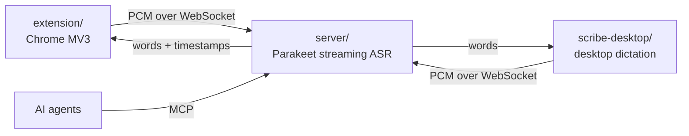

<!-- logo goes here -->

# scribe

Live meeting transcription on your own GPU. A browser extension streams a
meeting's audio to a self-hosted speech recognition server, which sends back
captions as people talk, labels who said what, and keeps every meeting
searchable by AI agents over MCP. The same server also powers push-to-talk
dictation on the desktop.

## Architecture



| Part | What it does |
| --- | --- |
| [`server/`](server) | FastAPI service running NVIDIA's `parakeet-unified-en-0.6b` (NeMo) with buffered streaming on CUDA. Takes 16 kHz PCM on `/ws` and streams back words with timestamps. Also serves an OpenAI-style `/v1/audio/transcriptions` endpoint, a web UI for saved sessions, and an MCP server (`/mcp`) to list, read, and search meeting transcripts and manage a vocabulary that boosts names and jargon. |
| [`extension/`](extension) | Chrome extension that captures a meeting tab's audio (Zoom, Google Meet) plus your own mic as a separate stream, and attributes each word to a speaker by joining word timestamps against the meeting's active-speaker indicator. Each meeting's participant names are boosted for its stream. See [`extension/README.md`](extension/README.md). |
| [`scribe-desktop/`](scribe-desktop) | AGS (GTK4) daemon for Hyprland: hold a key to talk and paste on release, or tap to type live until the next tap. Records with PipeWire and types through Hyprland. |

## Usage with Nix

```nix
{
  inputs.scribe.url = "github:xav-ie/scribe";

  # NixOS host with an NVIDIA GPU
  imports = [ inputs.scribe.nixosModules.default ];
  services.scribe.enable = true;
  # expose container port 8000 via virtualisation.oci-containers.containers.scribe

  # desktop
  home.packages = [ inputs.scribe.packages.${system}.scribe-desktop ];
}
```

The module builds the server image on the host (`build-scribe-image.service`)
so the multi-GB CUDA Python environment stays out of the Nix store, and runs it
with `podman` and the NVIDIA container toolkit.

## Development

```sh
nix flake check          # ruff, nixfmt, scribe-desktop build, module eval
cd extension && pnpm i && pnpm check && pnpm build
```

## License

MIT
