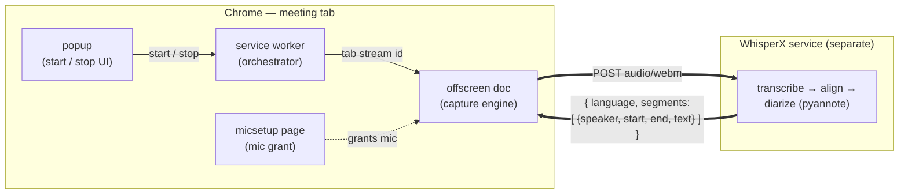

# Meeting Capture

A small **Chrome (Manifest V3)** extension that captures the audio of whatever
meeting tab you're on — **Zoom web client, Google Meet, Teams, Webex, anything
that runs in a tab** — and POSTs the recording to a self-hosted
[WhisperX](https://github.com/m-bain/whisperX) transcription service for
transcription + diarization.

It is deliberately a **thin capture client**. It only records and forwards audio.
Transcription, alignment and speaker diarization live in a separate, reusable
service so the capture layer stays swappable.

> Inspired by
> [`recallai/chrome-recording-transcription-extension`](https://github.com/recallai/chrome-recording-transcription-extension).
> This is **not a fork** — it's a fresh, audio-only, platform-agnostic rewrite
> (Vite + CRXJS + TypeScript) that drops the Google-Meet caption scraper and
> replaces the local download sink with an HTTP POST to a transcription service.

---

## Architecture



- **`src/background.ts`** — service worker. Brokers a tab `MediaStream` id via
  `chrome.tabCapture.getMediaStreamId()`, spins up the offscreen document, and
  tracks recording state.
- **`src/offscreen.ts`** — the capture engine. Opens the tab (and optional mic)
  stream, wires an `AudioContext` graph, records with `MediaRecorder`, and POSTs
  the final `audio/webm` blob to the configured endpoint.
- **`src/popup.{html,ts,css}`** — start/stop UI, mic + endpoint settings,
  transcript display.
- **`src/micsetup.{html,ts}`** — one-time microphone permission grant (the
  offscreen doc can't show a prompt).

### Why tab capture (and its one hard limit)

`tabCapture` grabs whatever tab is active when you click the extension — it runs
off the user gesture / `activeTab`, not off any meeting-host permission — so it
works on any in-tab meeting with zero platform-specific code.

The ceiling: you only get the **post-mix** stream — every remote participant is
already blended into one track. Per-participant separation is impossible from a
tab capture; separating the remote side is pyannote's job in the service. Your
own mic is the one voice you can cleanly isolate (see Roadmap).

---

## Develop

```bash
pnpm install
pnpm dev         # vite dev server with HMR
```

Load it: open `chrome://extensions`, enable **Developer mode**, **Load
unpacked**, and select the `dist/` directory (after a build) or the dev-served
build per CRXJS instructions.

## Build

```bash
pnpm build       # writes ./dist
```

Then **Load unpacked** → `./dist`.

## Quality gates

```bash
pnpm check       # runs types + lint + format + knip in parallel
pnpm lint        # eslint --fix
pnpm format      # prettier --write
pnpm icons       # regenerate icons (needs ImageMagick `magick` on PATH)
```

Stack: pnpm, flat ESLint (typescript-eslint, unicorn, sonarjs, import-x,
regexp, n), Prettier (single quotes), knip, with `minimumReleaseAge`
supply-chain hygiene.

## CI / Releases

Two GitHub Actions workflows (`.github/workflows/`):

- **Checks** — on every push to `main` and every PR, runs `check:types`,
  `check:lint`, `check:format`, `check:knip` and a `build` in parallel.
- **Release** — on a `v*.*.*` tag, re-runs the checks, builds, zips `dist/` into
  `meeting-capture-extension-<version>.zip` (manifest at the zip root) and cuts a
  GitHub Release with auto-generated notes. A manual `workflow_dispatch` run
  builds and uploads the zip as an artifact without creating a release.

Cut a release — `pnpm version` keeps the tag and `package.json` (and therefore
the built `manifest.json`) in lockstep, which the workflow enforces:

```bash
pnpm version patch        # bumps package.json, commits, tags v0.1.1
git push --follow-tags    # pushes the commit + tag → triggers Release
```

Publishing to the Chrome Web Store is wired up but commented out in
`release.yml` — enable it once a CWS listing exists and the `CWS_*` secrets are
set.

## Configure the endpoint

Set the transcription endpoint in the popup (persisted via `chrome.storage`).
Default: `http://localhost:8000/transcribe`.

If you point it at a non-localhost host (e.g. the `praesidium` GPU box over
Tailscale), add that origin to `host_permissions` in `manifest.config.ts` and
rebuild — a few common ones are pre-listed there.

## Service contract

The extension POSTs the raw recording and expects JSON back:

```
POST <endpoint>
Content-Type: audio/webm
body: <audio/webm;codecs=opus bytes>

200 OK
{
  "language": "en",
  "segments": [
    { "speaker": "SPEAKER_00", "start": 1.2, "end": 4.8, "text": "..." }
  ]
}
```

The service must send permissive CORS headers
(`Access-Control-Allow-Origin`) so the offscreen page can read the response.
The WhisperX service that satisfies this contract is maintained separately.

## Usage

1. Start the transcription service.
2. Join a meeting in a Chrome tab.
3. Click the extension icon → optionally **Capture my microphone** (grant once
   via the `grant access` link) → **Start recording**.
4. **Stop** — the offscreen doc POSTs the audio and renders the returned
   transcript.

Inspect logs at `chrome://extensions` → this extension → **service worker** →
_Inspect_ (look for `[offscreen]` messages).

---

## Gotchas

| Symptom                                 | Cause / fix                                                                                                                                  |
| --------------------------------------- | -------------------------------------------------------------------------------------------------------------------------------------------- |
| Can't hear the meeting while recording  | Tab capture mutes the tab; the offscreen doc reconnects `tabSource → ctx.destination` to keep playback. If broken, that's the line to check. |
| No mic in the recording                 | Grant via the `grant access` link (`micsetup.html`); also check OS-level mic permission for Chrome.                                          |
| Audio freezes/gaps mid-recording        | You switched away from the meeting tab; Chrome throttles background tabs. Stay on the tab.                                                   |
| "Offscreen not ready" / nothing records | Reload the extension in `chrome://extensions`.                                                                                               |
| POST blocked (CORS or net)              | Add the endpoint origin to `host_permissions` and ensure the service returns `Access-Control-Allow-Origin`.                                  |

---

## Roadmap

- **Mic as a separate track** — upload tab + mic as two parts so pyannote only
  separates the remote side and your own speech is perfectly attributed.
- **Persist transcripts** in the service (JSON + rendered Markdown), keyed by
  timestamp — keep the extension a dumb capture client.
- **Live/streaming path** — tap the offscreen `AudioContext` with an
  `AudioWorklet`, stream PCM over a WebSocket to a chunked decoder
  (`faster-whisper` + `diart`), keeping the batch endpoint for the final pass.
- **Lock down CORS / `host_permissions`** to the stable `chrome-extension://<id>`
  origin once published.

### Known reliability ceiling

MV3 forbids auto-starting capture without a user gesture, capture dies if the
meeting tab is closed/refreshed, and background tab throttling can briefly
freeze audio. For always-on, unattended, gap-free capture, move the capture
layer to an in-meeting bot or desktop recorder — and keep this same WhisperX
service as the transcription backend. The service is the durable asset; the
capture layer is swappable.

## License

MIT
