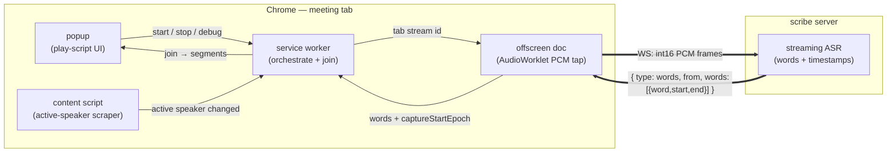

# Meeting Capture

A small **Chrome (Manifest V3)** extension that **streams** the audio of a
meeting tab (**Google Meet, Zoom web client**) to a self-hosted **streaming ASR
service** for live transcription, and labels the captions with **real speaker
names** by reading the meeting UI's active-speaker indicator.

It is deliberately a **thin client**. It captures audio, streams it, and scrapes
who's talking. Transcription happens on the [scribe server](../server), so the
capture layer stays swappable.

> Inspired by
> [`recallai/chrome-recording-transcription-extension`](https://github.com/recallai/chrome-recording-transcription-extension).
> Built with Vite + CRXJS + TypeScript.

---

## How it works

Two independent live signals are joined to produce a speaker-attributed
transcript:

1. **Audio → words.** The offscreen document taps the tab's audio with an
   `AudioWorklet`, converts it to 16-bit PCM, and streams it over a **WebSocket**
   to the ASR service, which streams back incremental text **with per-word
   timestamps**.
2. **Who's talking.** A content script in the meeting tab watches the active-
   speaker indicator and reports `{ name, time }` changes.

The background worker joins them by timestamp: each word is attributed to
whoever was the active speaker when it was spoken. **Diarization is not done from
the audio** — it reuses the meeting platform's own per-participant detection.



### Why this shape

Tab capture only gives you the **post-mix** stream — every remote participant is
already blended into one track, so audio-only diarization can't tell them apart,
caps out at a few speakers, and only ever emits anonymous `SPEAKER_00` labels.
The meeting client, however, already computes who's speaking from each
participant's individual mic and shows it in the UI **with their real name**.
Scraping that sidesteps the whole problem: **real names, unlimited speakers, ~no
extra compute** — at the cost of per-platform DOM selectors that need occasional
tuning (see below).

### Components

- **`src/background.ts`** — service worker. Brokers the tab `MediaStream` id,
  manages the offscreen doc, and **joins** the streamed words against the active-
  speaker timeline into the speaker-attributed transcript (persisted in
  `chrome.storage.local` so it survives the worker being torn down).
- **`src/offscreen.ts`** + **`public/pcm-worklet.js`** — the capture engine. Wires
  an `AudioContext` graph, taps PCM on the audio thread with an `AudioWorklet`,
  and streams it over a WebSocket. Your mic is always its own stream.
- **`src/speaker/`** — the active-speaker scraper (content script). `meet.ts` and
  `zoom.ts` are per-platform adapters; `index.ts` wires the matching one and
  reports changes; `transcript.ts` holds the timestamp-join logic.
- **`src/options.{html,ts}`** — the settings page: server URL and its host permission
- **`src/popup.{html,ts,css}`** — start/stop, toggles, and the live play-script
  transcript (speaker legend + colour-coded turns).
- The settings page also holds the one-time microphone permission grant (the
  offscreen doc can't show a prompt).

### Active-speaker detection (the brittle part)

These adapters read obfuscated meeting-client DOM, so expect to re-tune them.

- **Google Meet** — Meet exposes no stable "speaking" marker (no tile attribute,
  no CSS animation; every identifier is a hash it rotates every couple of
  months). So detection is **token-independent**: the speaking tile's audio meter
  animates, mutating its `class` far faster than idle tiles, so we tally visible
  `class` mutations per `[data-participant-id]` tile and pick the busiest. Names
  come from the (stable) name wrapper.
- **Zoom web** — uses stable BEM classes; the active tile gets an `--active`
  modifier, which is polled.

Turn on **Debug** in the popup to log detection to the **meeting tab's** console
(`[speaker] active: <name>` on change, plus a `{tiles, names, speaking}` dump).
The service worker console gets `[bg] …` join logs and a `scribe.*` test API
(`scribe.session()`, `scribe.inject('Name')`).

---

## Develop

```bash
pnpm install
pnpm dev         # vite dev server with HMR
```

Load it: open `chrome://extensions`, enable **Developer mode**, **Load
unpacked**, and select the `dist/` directory (after a build).

## Build

```bash
pnpm build       # writes ./dist
```

Then **Load unpacked** → `./dist`. After changes, hit the extension's reload
icon, and **refresh the meeting tab** so the content script re-injects.

## Quality gates

```bash
pnpm check       # runs types + lint + format + knip + unit tests in parallel
pnpm test        # vitest in watch mode
pnpm lint        # eslint --fix
pnpm format      # prettier --write
# icons, logos and the palette come from ../scripts/assets.mjs (run it in nix develop)
```

Stack: pnpm, flat ESLint (typescript-eslint, unicorn, sonarjs, import-x,
regexp, n), Prettier (single quotes), knip.

## CI / Releases

CI and releases live at the repository root (`.github/workflows/`): every push
and PR runs the extension's types, lint, format, knip, unit tests, build and
accessibility check. Releases use [knope](https://knope.tech): add a change
note with `knope document-change` (in `nix develop`), and one release PR stays
open and up to date with the next version and the changelog since the last
release. Merging it builds
`dist/` into `meeting-capture-extension-v<version>.zip` (manifest at the zip
root) on a `v<version>` GitHub release. `manifest.config.ts` reads
`package.json`, so the manifest's version always matches the tag.

## Configure the service

Set the streaming ASR **WebSocket URL** on the extension's options page
(**settings** link in the popup, or right-click the icon → Options). It is
persisted via `chrome.storage`. There is no default: the options page opens on
install, and recording asks for a server until one is set.

If the extension can't reach that host yet, the page explains why it needs
access and asks Chrome for it only when you click **Allow access** (from
`optional_host_permissions`). A local `ws://localhost:8000` is granted at
install.

## Service contract

The extension opens one WebSocket per stream (the tab, and the mic when it's
granted) and speaks the protocol described in the
[top-level README](../README.md#streaming-protocol): a JSON hello with the
sample rate, session id, channel, whether to save audio and the participants'
names to boost, then int16 PCM; the server streams back word updates that
replace the stream's words from an index on. Word times are seconds from the
stream's first sample, which the extension maps to wall-clock time to line them
up with the speaker timeline. At stop it posts the session's full record to
`/api/sessions/<sessionId>` for the server's web UI and MCP tools, retrying
later if that fails.

## Usage

1. Start the streaming ASR service and make its URL reachable from the browser.
2. Join a meeting in a Chrome tab (Google Meet or Zoom web).
3. Click the extension icon → **Start recording**. Your mic is always recorded
   (grant it once via `grant access`), except while you're muted in the meeting.
4. Watch the transcript fill in, grouped by speaker. **Stop** when done.

---

## Gotchas

| Symptom                                 | Cause / fix                                                                                                                                                                                                                                             |
| --------------------------------------- | ------------------------------------------------------------------------------------------------------------------------------------------------------------------------------------------------------------------------------------------------------- |
| Everyone shows as **`Unknown`**         | The active-speaker scraper isn't firing. Reload the extension **and refresh the meeting tab**; with Debug on, check the meeting tab console. If Meet rotated its DOM, the `[data-participant-id]`/name selectors in `speaker/meet.ts` may need a tweak. |
| Can't hear the meeting while recording  | Tab capture mutes the tab; the offscreen doc reconnects `tabSource → ctx.destination` to keep playback. If broken, that's the line to check.                                                                                                            |
| No mic in the recording                 | Allow it under Microphone on the settings page (the popup's `grant access` link opens it); also check OS-level mic permission for Chrome.                                                                                                               |
| Audio freezes/gaps mid-recording        | You switched away from the meeting tab; Chrome throttles background tabs. Stay on the tab.                                                                                                                                                              |
| Nothing records / "offscreen not ready" | Reload the extension in `chrome://extensions`.                                                                                                                                                                                                          |
| WebSocket won't connect                 | Save the server on the options page again so Chrome asks for access to its host, confirm the server is reachable, and that TLS validates.                                                                                                               |

---

## Roadmap

- **Transcript export** — copy / download the play-script (Markdown or JSON).
- **More platforms** — Teams/Webex adapters (the audio path is already platform-
  agnostic; only the active-speaker selectors are per-platform).

### Known reliability ceiling

MV3 forbids auto-starting capture without a user gesture, capture dies if the
meeting tab is closed/refreshed, and background tab throttling can briefly freeze
audio. For always-on, unattended capture, move the capture layer to an in-meeting
bot or desktop recorder — and keep this same streaming service as the backend.
The service is the durable asset; the capture layer is swappable.

## License

MIT
