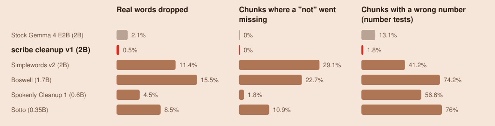

# How scribe cleanup compares

Given the same meeting transcript, which small model on your own computer cleans it best without changing what was
said?

<!-- table:comparison-verdict -->
In short: scribe cleanup makes the fewest errors and drops 0.5% of real words; the dictation models drop 4.5% to 15.5%, and lose a "not" in 1.8% to 29.1% of meeting chunks.
<!-- /table:comparison-verdict -->

**What was compared.** Every released open transcript-cleanup model we found that is small enough for a laptop, plus
two simple baselines:

- **Raw transcript:** the speech-to-text output, untouched.
- **Rules only:** a simple script that deletes ums and repeated words.
- **Stock Gemma 4 E2B:** scribe cleanup's starting model without our training, given detailed instructions instead.
  It shows what the training adds.
- **Simplewords, Boswell, Spokenly and Sotto:** cleanup models built for dictation, where one person dictates one
  sentence at a time. Each meeting line was sent to them on its own, with each model's own instructions. Boswell's
  page says it is meant to run inside its Mac app, so it got the instructions that app sends.

Size is the number of learned values in a model, in billions (B); bigger usually means slower. Each model takes hours
to run, so all of them ran on every third chunk of the tests; that is why the numbers differ slightly from the model
card, which uses every chunk. Scores are each model's own output, before any safety check, and
[METHODOLOGY.md](METHODOLOGY.md#scoring) explains them.

<!-- diagram:quality -->
<picture>
  <source media="(prefers-color-scheme: dark)" srcset="../diagrams/quality-dark.svg">
  
</picture>
<!-- /diagram:quality -->

<!-- diagram:losses -->
<picture>
  <source media="(prefers-color-scheme: dark)" srcset="../diagrams/losses-dark.svg">
  
</picture>
<!-- /diagram:losses -->

<!-- table:comparison-quality -->
**How clean the result is, on meetings** (110 chunks; for every score, see [the definitions](METHODOLOGY.md#scoring))

| System | Size | Word errors | Word, punctuation and capital errors | Punctuation (0 to 1) | Capitals (0 to 1) | Filler removal (0 to 1) |
|---|---|---|---|---|---|---|
| Raw transcript |  | 6.7% | 23.1% | 0.23 | 0.53 | n/a |
| Rules only (drop fillers and repeats) |  | 2.7% | 20.8% | 0.23 | 0.59 | 0.76 |
| Stock Gemma 4 E2B (with a detailed prompt) | 2B | 5.3% | 23.7% | 0.20 | 0.48 | 0.60 |
| **scribe cleanup v1** | 2B | 1.3% | 13.4% | 0.58 | 0.78 | 0.88 |
| [Simplewords v2](https://huggingface.co/ReFyneLabs/simplewords-dictation-cleanup-v2) | 2B | 16% | 29.6% | 0.46 | 0.62 | 0.41 |
| [Boswell](https://huggingface.co/meetboswell/boswell-dictation-cleanup) | 1.7B | 23% | 37.2% | 0.40 | 0.62 | 0.26 |
| [Spokenly Cleanup 1](https://huggingface.co/spokenly/cleanup-1) | 0.6B | 9.6% | 26.5% | 0.41 | 0.62 | 0.56 |
| [Sotto](https://huggingface.co/juanquivilla/sotto-cleanup-lfm25-350m) | 0.35B | 14.3% | 29.6% | 0.41 | 0.61 | 0.47 |
<!-- /table:comparison-quality -->

<!-- table:comparison-safety -->
**What gets lost** (meetings: 110 chunks; number tests: 221 chunks)

| System | Real words dropped | Missing "not" | Wrong number | Wrong number (number tests) | Unsure number converted (number tests) | Correction not applied (number tests) | Lines kept intact |
|---|---|---|---|---|---|---|---|
| Stock Gemma 4 E2B (with a detailed prompt) | 2.1% | 0% | 4.5% | 13.1% | 3.6% | 30.3% | 92.7% |
| **scribe cleanup v1** | 0.5% | 0% | 2.7% | 1.8% | 0% | 0% | 99.1% |
| [Simplewords v2](https://huggingface.co/ReFyneLabs/simplewords-dictation-cleanup-v2) | 11.4% | 29.1% | 23.6% | 41.2% | 0.4% | 0% | n/a (one line at a time) |
| [Boswell](https://huggingface.co/meetboswell/boswell-dictation-cleanup) | 15.5% | 22.7% | 36.4% | 74.2% | 0% | 0% | n/a (one line at a time) |
| [Spokenly Cleanup 1](https://huggingface.co/spokenly/cleanup-1) | 4.5% | 1.8% | 11.8% | 56.6% | 38.9% | 0.4% | n/a (one line at a time) |
| [Sotto](https://huggingface.co/juanquivilla/sotto-cleanup-lfm25-350m) | 8.5% | 10.9% | 24.6% | 76% | 29% | 2.7% | n/a (one line at a time) |
<!-- /table:comparison-safety -->

**Why the dictation models lose meaning.** They were built to polish one dictated sentence, so on messy meeting speech
they rewrite: they invent endings, drop the half of a sentence that says "not", and guess what an unclear number
meant. Real outputs from the tests, with the changed part in bold:

| Model | What went wrong | Heard | The model wrote | scribe cleanup wrote |
|---|---|---|---|---|
| Boswell | invented an ending | yeah and I think today there | Yeah and I think today there **is no way we finish the report by Friday.** | Yeah. And I think today there |
| Boswell | invented a number | the next channel in the numeric pattern or no swapping | The next channel in the numeric pattern **is: 12.** | The next channel in the numeric pattern or? No swapping. |
| Simplewords v2 | dropped the "don't" half | we do want drop-down we don't want them to type them do we | We do want drop-downs. | We do want drop-down. We don't want them to type them, do we? |
| Simplewords v2 | dropped the "didn't" | did and some classes didn't yeah | Did some classes. | did and some classes didn't. Yeah. |
| Sotto | changed a number | the target was fourteen fifty I think | The target was **146**. | The target was fourteen fifty I think. |
| Spokenly Cleanup 1 | guessed a time | we can regroup at half past eight | We can regroup at **18:30**. | We can regroup at half past eight. |

The first four are real meeting lines; the last two are made-up lines from the number tests. None of this ranks these
models at dictation, the job they were built for.
